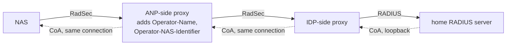
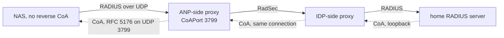
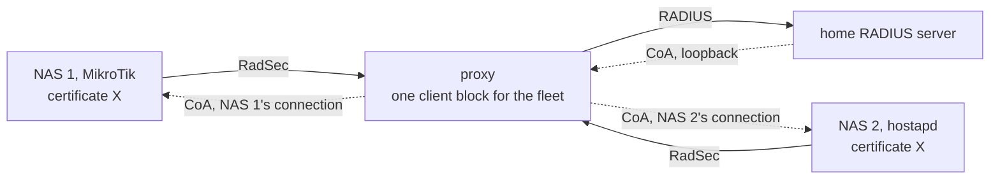
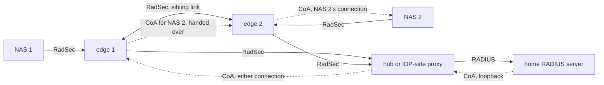

# radsecproxy: reverse CoA proof of concept

This branch, `reverse-coa-poc`, is radsecproxy with reverse CoA
(draft-ietf-radext-reverse-coa, with RFC 8559 routing), for implementers who want to try
it before it is merged upstream. For radsecproxy itself see [README](README) and
[radsecproxy.org](https://radsecproxy.github.io/).

## What reverse CoA does

A NAS behind NAT or a firewall opens an outbound RadSec (RADIUS/TLS) connection to a
proxy and never listens for CoA. With reverse CoA, the home RADIUS server's proxy sends
CoA-Request and Disconnect-Request *back down* that existing connection, hop by hop, to
the proxy next to the NAS, which delivers it on the NAS's own connection. Nothing has to
reach the NAS from the outside. A NAS without reverse CoA of its own can still be reached
by its proxy over plain RFC 5176 UDP on the last hop.

In the pictures below, solid arrows are the way up (Access-Request, Accounting-Request,
and their replies back along the same arrows), dotted arrows are the way down
(CoA-Request, Disconnect-Request, and their ACK or NAK back the same way). Every arrow
between a NAS and a proxy, or between two proxies, is one RadSec connection the NAS or
the proxy opened outbound; the way down rides on the connection the way up opened.

**Two proxies**, the OpenRoaming shape: the access network (ANP) runs a proxy next to
its NASes, the identity provider (IDP) runs one in front of its RADIUS server, and the
two proxies talk RadSec to each other, directly or through a hub. The ANP proxy adds
Operator-Name and Operator-NAS-Identifier on the way up and strips them on the way down.

**UDP last hop**: a NAS that speaks plain RADIUS over UDP to its proxy and has no
reverse CoA. The way down to it is an ordinary RFC 5176 request on UDP 3799, which the
NAS has to accept from the proxy's address (`anp-proxy-udp-nas.conf`). Run on the bench
with the router over UDP into a single proxy, section 6 of the RouterOS record, after the
same path through two proxies on 7 October.

The last hop, case by case:

- NAS over RadSec, CoA on that same connection: in the code, run on the bench
  (MikroTik RouterOS, hostapd with the reverse CoA series).
- NAS over plain RADIUS, CoA back on UDP 3799: in the code, run on the bench
  (MikroTik RouterOS).
- NAS over RadSec that does not take CoA on that connection, CoA out on UDP 3799: not in
  the code, not tested. The proxy only sends the UDP last hop to a client that spoke UDP
  itself. Controllers and access points that speak RadSec but have only classic RFC 5176
  dynamic authorization sit here; this is the next piece of work.

**One proxy**, the enterprise and operator shape: the NASes, often a whole fleet on one
client certificate, connect straight to the proxy in front of the home server. One
client block serves the fleet; the proxy tells the connections apart by the
NAS-Identifier each one sends, and the Operator-NAS-Identifier it adds names that NAS,
not the connection, so a NAS that reconnects is still reached.

**Two proxies at one site**: both take NAS connections and both connect to the hub, and
the hub sends the CoA down either connection, routing on Operator-Name only. The proxy
that receives it delivers to its own NAS or hands the request to the other over a link
between the two (`ReverseCoASibling`), once. The hub keeps no record of which proxy or
connection a session was seen on (RFC 8559 section 2.1); the site does its own routing
(section 2.2).

Run on the bench on 30 October 2026, eight cases including the hand-over, the router moving
between the edges and the link down: [`docs/testing/two-edge-site.md`](docs/testing/two-edge-site.md).

How a request finds its NAS, what the originator has to send, the two forms of
`NASidentifier` (one NAS per block, or a fleet) and the sibling link are explained in
[`examples/reverse-coa/README.md`](examples/reverse-coa/README.md).

## What is on this branch

- The code exactly as it stands in the upstream pull requests
  [#206](https://github.com/radsecproxy/radsecproxy/pull/206) (CoA proxying by
  Operator-Name) and [#186](https://github.com/radsecproxy/radsecproxy/pull/186)
  (reverse CoA), taken from the PR branches by commit; the base of this branch is the
  current head of #186, which includes the commit for many NASes on one client
  certificate. When the pull requests move, this branch is rebased onto them.
- [`examples/reverse-coa/`](examples/reverse-coa/): configuration for the IDP-side and
  ANP-side proxies, for a single proxy with the NAS connecting straight to it, a RouterOS
  snippet, and a README that explains the roles.
- [`docs/testing/`](docs/testing/): bench records against real NAS equipment, with the
  logs from every hop: MikroTik RouterOS 7.23.8 through two proxies, and MikroTik plus
  hostapd on one certificate through one proxy.
- [`tools/coaprobe.py`](tools/coaprobe.py): sends a CoA-Request or Disconnect-Request to a
  proxy, for testing without a RADIUS server that can originate CoA.

## Packages

Every push runs the test suite and builds, for x86_64:

- a `.deb` for Debian 12 or later and Ubuntu 22.04 or later, and an `.rpm` for RHEL,
  Rocky, Alma and CentOS Stream 9. They install `/usr/sbin/radsecproxy`, a
  `radsecproxy.service` unit (not enabled), `/etc/radsecproxy.conf` as a placeholder
  you replace, the man pages, and the examples and testing records under
  `/usr/share/doc/radsecproxy/`. The version sorts below upstream's 1.12.0, so a
  distribution package replaces this one on upgrade.
- the same two builds as tarballs, to unpack anywhere and run with `-c <config>`.
- a container image, `ghcr.io/cyb0rgg/radsecproxy:reverse-coa-poc`, with the config,
  certificates and keys mounted under `/etc/radsecproxy/`.

They are attached to each run under [Actions](../../actions), and to a
[release](../../releases) for every `reverse-coa-poc-*` tag, each with a `.sha256`.
`BUILD.txt` in every package names the commit it was built from. The binaries link the
system OpenSSL dynamically.

## What the bench showed

Things you will run into. The logs are in `docs/testing/`.

- RouterOS applies `Mikrotik-Rate-Limit`, `Session-Timeout` and `Idle-Timeout` from a
  CoA to the live session. Session-Timeout is the total session time, not the remaining
  time. Idle-Timeout is checked against the idle time already accumulated.
- RouterOS accepts the CoA on its RadSec connection with `/radius incoming` off; the
  setting is for UDP 3799 and is not needed here. It is needed for the UDP last hop,
  which RouterOS takes on 3799 from the address of a configured RADIUS server.
- With `protocol=radsec` RouterOS connects to port 2083 whatever the port fields say,
  and verifies the proxy's certificate against the configured address: the certificate
  needs the proxy's IP address in its subjectAltName.
- RouterOS 7.23.8 negotiates TLS 1.2 with the proxy; hostapd negotiates TLS 1.3.
- hostapd needs the RADIUS/TLS reverse CoA series posted to the hostap mailing list in
  October 2026; stock hostapd has no reverse CoA.
- hostapd matches User-Name in a Disconnect-Request against the outer EAP identity and
  does not accept Framed-IP-Address in it (NAK 401).
- Many NASes on one client certificate: before the fleet commit the value in
  Operator-NAS-Identifier was the same for all of them and a request for one could
  reach another; now the value is per site and the NAS the request names wins. Use
  `NASidentifier /.*/` on a block that serves a fleet.

## Status

Tested end to end on the bench: CoA-Request and Disconnect-Request from a home server,
through two proxies over RadSec, to a MikroTik RouterOS HotSpot and to hostapd, and
through a single proxy to a MikroTik and a hostapd sharing one certificate, with the
session changed or ended as requested. See `docs/testing/`. This is a proof of concept
for evaluation; the code under review upstream is the authority on behaviour.

## Feedback

Test reports are welcome as issues on this fork: NAS make and firmware, the proxy logs at
debug level for the CoA exchange, and the NAS's own log. Bugs in the proposed code
itself belong on the upstream pull requests.
