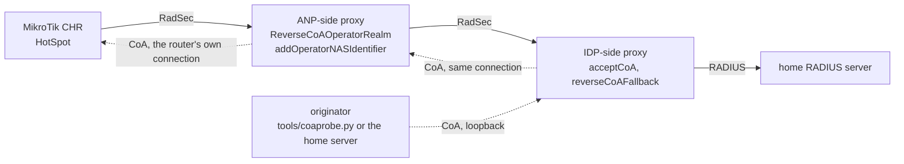

# Reverse CoA to a MikroTik RouterOS HotSpot

Bench record for reverse CoA (draft-ietf-radext-reverse-coa, RFC 8559 routing)
delivered to a MikroTik HotSpot over the router's own RadSec connection, with
the changes applied mid-session. RouterOS 7.23.8 (long-term) on a CHR.
Date: 22 October 2026.

## Topology

Solid arrows: the way up, Access-Request and Accounting-Request. Dotted arrows: the way
down, CoA-Request and Disconnect-Request, each on the connection the way up opened.



Every hop between the proxies and the router is RadSec. The only UDP in the picture is
the originator on the IDP host talking to its own proxy on loopback, which is how a
RADIUS server that originates CoA would do it as well.

- The NAS connects outbound to the ANP proxy over RadSec and receives the
  CoA on that connection; nothing reaches it from outside. `/radius incoming`
  (the RouterOS setting for unsolicited RADIUS requests on UDP 3799) is not
  needed for this: section 5 runs the same CoA with it off and with it on.
- The ANP proxy stamps Operator-Name and a keyed Operator-NAS-Identifier on the
  Access-Request and Accounting-Request towards the IDP proxy
  (`ReverseCoATokenKey`), so the IDP side needs no per-NAS configuration.
- The IDP proxy takes a CoA-Request or Disconnect-Request from a local client
  (`acceptCoA` plus `reverseCoAFallback`), matches the Operator-Name against the
  `ReverseCoAOperatorRealm` of the connected ANP proxy and sends the request
  down that connection. The ANP proxy picks the NAS by the Operator-NAS-Identifier
  it minted, strips Operator-Name and Operator-NAS-Identifier, and forwards on the
  NAS's RadSec connection.

Relevant configuration, IDP proxy:

```
ListenUDP 127.0.0.1:3799
ReverseCoATokenKey <key shared with the ANP proxy>

client anp-proxy {
    type tls
    ...
    ReverseCoAOperatorRealm 4EXAMPLE:GB
}

client originator {
    type udp
    host 127.0.0.1
    secret ...
    acceptCoA on
    reverseCoAFallback on
}
```

ANP proxy:

```
ReverseCoATokenKey <same key>

client nas-radsec {
    type tls
    host <nas address>
    ...
    NASidentifier <nas identifier>
    ReverseCoAOperatorRealm 4EXAMPLE:GB
    rewriteIn addoperatorname
    addOperatorNASIdentifier on
}

server idp-proxy {
    type tls
    ...
    acceptReverseCoA on
}
```

RouterOS:

```
/radius add service=hotspot address=<anp proxy> authentication-port=2083 \
    accounting-port=2083 protocol=radsec certificate=<client cert> \
    require-message-auth=yes-for-request-resp
```

`/radius incoming` was `accept=yes` during sections 1 to 3 and is switched off
and on in section 5.

## The session

A phone logs in on the HotSpot through the captive portal (user `tester3`).
The Accounting-Request Start as recorded at the IDP:

```
Acct-Status-Type = Start
User-Name = "tester3"
Acct-Session-Id = "80f00003"
Framed-IP-Address = 10.5.50.254
Chargeable-User-Identity = 0x3935383934...
NAS-Identifier = "<nas identifier>"
Operator-Name = "4EXAMPLE:GB"
Operator-NAS-Identifier = 0x39353636643831323233306530653132
```

The CUI is returned by the IDP in the Access-Accept and echoed by RouterOS in
every accounting packet (RouterOS logs it as `Unknown-Attribute(type=89)`, but
echoes it). The Operator-NAS-Identifier is the keyed token minted by the ANP
proxy; it was the same value on the next login, as intended.

Every CoA-Request below carries User-Name, Acct-Session-Id, Framed-IP-Address,
NAS-IP-Address, NAS-Identifier, Event-Timestamp and Operator-Name, plus the
attributes being changed. The originator is a small Python probe
(`tools/coaprobe.py` in this repository) sending to the IDP proxy's loopback
listener.

## 1. Rate limit, 2M/2M

```
07:57:58Z sent CoA-Request id 118: Mikrotik-Rate-Limit=2M/2M
reply after 4.4 ms: CoA-ACK id 118, response authenticator valid
```

IDP proxy:

```
radsrv: code 43, id 118
findcoaserver: no realm matches operator-name 4EXAMPLE:GB
send_coa_to_client: forwarding CoA-Request (id 118 -> 0) to client anp-proxy
radsrv: CoA-Request (id 118) from originator (127.0.0.1) sent down a reverse coa route
forward_coa_response: CoA-ACK (id 0) from client anp-proxy answers request id 118 from client originator
```

ANP proxy:

```
handle_reverse_coa_request: received CoA-Request (id 0) from server idp-proxy
send_coa_to_client: forwarding CoA-Request (id 0 -> 0) to client nas-radsec (nas)
tlsserverwr: sent 108 bytes, Radius packet of length 108 to <nas>
forward_coa_response: CoA-ACK (id 0) from client nas-radsec answers request id 0 from server idp-proxy
```

RouterOS (`/log print`, radius,debug):

```
radius,debug,packet rx CoA-Request with id 0 from <anp proxy>:2083
radius,debug,packet     User-Name = "tester3"
radius,debug,packet     Acct-Session-Id = "80f00003"
radius,debug,packet     Framed-IP-Address = 10.5.50.254
radius,debug,packet     MT-Rate-Limit = "2M/2M"
radius,debug received remote request 1 code=CoA-Request from <anp proxy>:2083
radius,debug tx CoA-ACK to remote request 1
```

RouterOS applies it as a dynamic simple queue on the session, without any
change to the session itself:

```
/queue simple print detail
 0  D name="<hotspot-tester3>" target=10.5.50.254/32 ... limit-at=2M/2M max-limit=2M/2M
/ip hotspot active print detail
 0 R  server=075-Free user="tester3" address=10.5.50.254 uptime=2m22s session-time-left=11h57m38s
```

## 2. Rate limit, 256k/256k, then 20M/20M

Same path, CoA-ACK in 3.9 ms and 4.0 ms. The queue is rewritten each time:

```
 2  D name="<hotspot-tester3>" ... limit-at=256k/256k max-limit=256k/256k
 3  D name="<hotspot-tester3>" ... limit-at=20M/20M max-limit=20M/20M
```

The session was untouched (uptime 4m47s, no re-login).

## 3. Session-Timeout is the total session time, not the remaining time

A CoA-Request with `Session-Timeout = 120` and `Mikrotik-Rate-Limit = 5M/5M`
was sent 315 s into the session. RouterOS log, three lines in the same second,
in this order:

```
radius,debug,packet rx CoA-Request with id 3 from <anp proxy>:2083
radius,debug,packet     Session-Timeout = 120
radius,debug,packet     MT-Rate-Limit = "5M/5M"
radius,debug received remote request 4 code=CoA-Request from <anp proxy>:2083
hotspot,info,debug tester3 (10.5.50.254): logged out: session timeout
radius,debug tx CoA-ACK to remote request 4
```

The Accounting Stop carried `Acct-Terminate-Cause = Session-Timeout` and
`Acct-Session-Time = 315`. RouterOS reads Session-Timeout in a CoA the way
RFC 2865 defines it, as the maximum number of seconds of service counted from
the start of the session: 315 s had already elapsed, 120 is less than that, so
the session ended at once, and the request was ACKed.

The positive case, on a fresh session (`80f00005`), `Session-Timeout = 180`
sent 24 s after login:

```
before: uptime=22s session-time-left=11h59m38s
reply after 4.4 ms: CoA-ACK
after:  uptime=24s session-time-left=2m36s
```

2m36s is 180 - 24. The session ended 180 s after login, Stop with
`Acct-Terminate-Cause = Session-Timeout`, `Acct-Session-Time = 180`. To cap or
extend a running session, send a Session-Timeout larger than the elapsed time.

## 4. Idle-Timeout

Second login, session `80f00009`, 58 s old at this point and with no traffic
from the phone since the login.

```
08:39:50Z sent CoA-Request id 99: Idle-Timeout=30
reply after 3.0 ms: CoA-ACK id 99, response authenticator valid
```

RouterOS:

```
radius,debug,packet rx CoA-Request with id 2 from <anp proxy>:2083
radius,debug,packet     Idle-Timeout = 30
radius,debug received remote request 8 code=CoA-Request from <anp proxy>:2083
hotspot,info,debug tester3 (10.5.50.254): trying to update via Radius CoA
hotspot,debug tester3 (10.5.50.254): idle timeout <30> from RADIUS
hotspot,info,debug tester3 (10.5.50.254): Radius CoA succeeded
hotspot,info,debug tester3 (10.5.50.254): logged out: idle timeout
hotspot,debug tester3 (10.5.50.254): sending RADIUS accounting Stop request
radius,debug tx CoA-ACK to remote request 8
```

The new idle timeout is applied against the idle time the session has already
accumulated: the phone had been idle for longer than 30 s, so the router logged
it out in the same instant, then sent the CoA-ACK and the Stop. Stop as received
at the IDP:

```
Acct-Status-Type = Stop
Acct-Terminate-Cause = Idle-Timeout
Acct-Session-Id = "80f00009"
Acct-Session-Time = 6
```

## 5. CoA on the RadSec connection with `/radius incoming` off

Same second login, session `80f00009`. Before the login:

```
/radius incoming set accept=no
/radius incoming print
  accept: no
    port: 3799
```

Rate limit CoA, 20 s after login:

```
08:39:12Z sent CoA-Request id 187: Mikrotik-Rate-Limit=2M/2M
reply after 4.9 ms: CoA-ACK id 187, response authenticator valid
```

IDP proxy:

```
radsrv: code 43, id 187
send_coa_to_client: forwarding CoA-Request (id 187 -> 5) to client anp-proxy
radsrv: CoA-Request (id 187) from originator (127.0.0.1) sent down a reverse coa route
forward_coa_response: CoA-ACK (id 5) from client anp-proxy answers request id 187 from client originator
```

ANP proxy:

```
handle_reverse_coa_request: received CoA-Request (id 5) from server idp-proxy
send_coa_to_client: forwarding CoA-Request (id 5 -> 0) to client nas-radsec (nas)
tlsserverwr: sent 108 bytes, Radius packet of length 108 to <nas>
forward_coa_response: CoA-ACK (id 0) from client nas-radsec answers request id 5 from server idp-proxy
```

RouterOS:

```
radius,debug,packet rx CoA-Request with id 0 from <anp proxy>:2083
radius,debug,packet     MT-Rate-Limit = "2M/2M"
radius,debug received remote request 6 code=CoA-Request from <anp proxy>:2083
hotspot,info,debug tester3 (10.5.50.254): trying to update via Radius CoA
hotspot,debug tester3 (10.5.50.254): rate limit <2M/2M> from RADIUS
hotspot,debug tester3 (10.5.50.254): adding queue <2M/2M>
hotspot,info,debug tester3 (10.5.50.254): Radius CoA succeeded
radius,debug tx CoA-ACK to remote request 6
/queue simple print detail
 4  D name="<hotspot-tester3>" target=10.5.50.254/32 ... limit-at=2M/2M max-limit=2M/2M
```

Then `/radius incoming set accept=yes` and a second CoA, `Mikrotik-Rate-Limit=256k/256k`
(id 102, CoA-ACK in 4.7 ms): same path, same log lines, `removing queue` then
`adding queue <256k/256k>`.

RouterOS processes a CoA that arrives on its own RadSec connection regardless of
`/radius incoming`. The setting was not needed for any of the tests on this page.

## 6. UDP last hop: the router over plain RADIUS, CoA back on UDP 3799

Later the same day, on the single proxy of the companion record, the router was moved
from RadSec to plain RADIUS over UDP into the proxy (`/radius` entry with
`protocol=udp`, ports 1822 and 1823), with `/radius incoming accept=yes`. The proxy's
client block for it:

```
client nas-udp {
    type udp
    host <nas>
    secret ...
    NASidentifier <nas identifier>
    ReverseCoAOperatorRealm 4EXAMPLE:GB
    rewriteIn addoperatorname
    addOperatorNASIdentifier on
    CoAPort 3799
}
```

Login over UDP, session `80f00025`, the proxy registering the router as a UDP client
for the realm and adding its Operator-NAS-Identifier on the accounting. Then, from the
originator:

```
18:36:51Z sent CoA-Request id 59: Mikrotik-Rate-Limit=2M/2M, Operator-NAS-Identifier <token>
reply after 5.0 ms: CoA-ACK id 59
  try_send_to_token_client: operator-nas-identifier names a client connection
  send_coa_to_client: forwarding CoA-Request (id 59 -> 6) to client nas-udp (nas)
18:36:52Z sent CoA-Request id 20: Mikrotik-Rate-Limit=256k/256k, no Operator-NAS-Identifier
reply after 2.4 ms: CoA-ACK id 20
  try_send_to_realm_clients: realm 4EXAMPLE:GB, the nas named in the request is registered
  send_coa_to_client: forwarding CoA-Request (id 20 -> 7) to client nas-udp (nas)
18:36:53Z sent Disconnect-Request id 150
reply after 2.7 ms: Disconnect-ACK id 150
  send_coa_to_client: forwarding Disconnect-Request (id 150 -> 8) to client nas-udp (nas)
```

On the wire the proxy sends from its UDP listener port to the router's 3799. RouterOS:

```
radius,debug,packet rx CoA-Request with id 6 from <proxy>:1822
radius,debug,packet     MT-Rate-Limit = "2M/2M"
radius,debug received remote request 14 code=CoA-Request from <proxy>:1822
hotspot,debug tester3 (10.5.50.254): adding queue <2M/2M>
hotspot,info,debug tester3 (10.5.50.254): Radius CoA succeeded
radius,debug,packet tx CoA-ACK with id 6 to <proxy>:1822
radius,debug,packet rx CoA-Request with id 7 from <proxy>:1822
hotspot,debug tester3 (10.5.50.254): removing queue
hotspot,debug tester3 (10.5.50.254): adding queue <256k/256k>
radius,debug,packet rx Disconnect-Request with id 8 from <proxy>:1822
hotspot,info,debug tester3 (10.5.50.254): logged out: radius disconnect
hotspot,debug tester3 (10.5.50.254): sending RADIUS accounting Stop request
```

Stop at the home server: `Acct-Terminate-Cause = Admin-Reset`, `Acct-Session-Time = 692`.

The same last hop was first run on 7 October through two proxies, with the April
revision of the upstream code, against the same router; this is the first run of it on
the reworked routing. One thing it does not cover: a NAS that speaks RadSec on the way
up and does not take CoA on that connection. The branch sends the UDP last hop only to a
client that spoke UDP itself.

## Notes on RouterOS behaviour

- Reverse CoA over the router's own RadSec connection works on RouterOS 7.23.x
  without any RouterOS change; the CoA arrives from the ANP proxy's address on
  port 2083 as far as RouterOS is concerned.
- RouterOS 7.23.8 negotiated TLS 1.2 (ECDHE-ECDSA-AES128-GCM-SHA256) with the
  ANP proxy (OpenSSL 3.5.7), as logged by radsecproxy at the handshake. hostapd
  connecting to the same proxy negotiates TLS 1.3 (TLS_AES_256_GCM_SHA384).
- `Mikrotik-Rate-Limit`, `Session-Timeout` and `Idle-Timeout` are applied to
  the live session, as the RouterOS RADIUS documentation lists for CoA.
  Rate-limit changes replace the dynamic queue; the session is not interrupted.
- Session-Timeout in a CoA is absolute (see 3). Idle-Timeout in a CoA is
  checked against the idle time already accumulated (see 4).
- `/radius incoming` is not needed for CoA on the RadSec connection (see 5). It is
  what takes the CoA on UDP 3799 in section 6; RouterOS accepts it from the address of
  a configured `/radius` server.
- The CHR's clock was about 6 s behind the proxies' during this run; the
  timestamps above are from each box's own log.

## Reproducing

1. Build this branch on the IDP proxy and the ANP proxy; set the same
   `ReverseCoATokenKey` on both.
2. RouterOS: a `/radius` entry with `protocol=radsec` pointing at the ANP proxy.
   `/radius incoming` can stay off.
3. Log a client in on the HotSpot, read the Acct-Session-Id from accounting.
4. `python3 tools/coaprobe.py 15 <user> <session-id> <framed-ip> coa:Mikrotik-Rate-Limit=2M/2M`
   on the IDP proxy host.
5. `/queue simple print detail` on the router.
