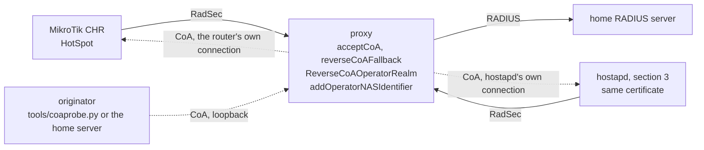

# Reverse CoA to a MikroTik RouterOS HotSpot, single proxy

The same router as in [mikrotik-routeros-hotspot.md](mikrotik-routeros-hotspot.md),
connected straight to the proxy in front of the home RADIUS server. No ANP-side
proxy. 22 October 2026, RouterOS 7.23.8 (CHR), this branch.

## Topology

Solid arrows: the way up. Dotted arrows: the way down, on the connection the way up
opened.



Configuration, as in `examples/reverse-coa/single-proxy.conf`: the router's client
block carries `NASidentifier`, `ReverseCoAOperatorRealm`, `addOperatorNASIdentifier` and
a rewrite that adds Operator-Name; the originator's client block has `acceptCoA` and
`reverseCoAFallback`. The router's block also has its own `tls` block, with a server
certificate that carries the proxy's IP address in the subjectAltName (see the note on
RouterOS below).

Sections 1 and 2 ran with one block for the router, `host <nas>` and a literal
`NASidentifier`, on the branch as it was before the fleet fix. Section 3 ran with the
fleet block of the example, `host 0.0.0.0/0`, certificate match, `NASidentifier /.*/`,
on the branch with the fix, and with a second NAS on the same certificate.

RouterOS:

```
/radius add service=hotspot address=<proxy> authentication-port=2083 \
    accounting-port=2083 protocol=radsec certificate=<client cert> \
    require-message-auth=yes-for-request-resp
```

## The session

```
tlsservernew: incoming TLS connection from <nas>
tlsservernew: TLS connection from <nas>, client nas-radsec, subject CN=..., TLSv1.2 ...
register_reverse_coa_client: client nas-radsec registered for realm 4EXAMPLE:GB
radsrv: got Access-Request (id 2) with username: tester3@<realm> from client nas-radsec (<nas>)
add_operator_nas_identifier: added <token> to Access-Request (id 2) from client nas-radsec
Access-Accept for user tester3 ... to nas-radsec (<nas>) operator 4EXAMPLE:GB
```

Session `80f0000e`, phone untouched after the login.

## 1. Rate limit, 2M/2M

```
09:01:33Z sent CoA-Request id 42: Mikrotik-Rate-Limit=2M/2M
reply after 4.0 ms: CoA-ACK id 42, response authenticator valid
```

Proxy:

```
radsrv: code 43, id 42
findcoaserver: no realm matches operator-name 4EXAMPLE:GB
try_send_to_realm_clients: realm 4EXAMPLE:GB, the nas named in the request is registered
send_coa_to_client: forwarding CoA-Request (id 42 -> 0) to client nas-radsec (nas)
radsrv: CoA-Request (id 42) from originator (127.0.0.1) sent down a reverse coa route
tlsserverwr: sent 108 bytes, Radius packet of length 108 to <nas>
forward_coa_response: CoA-ACK (id 0) from client nas-radsec answers request id 42 from client originator
```

RouterOS:

```
radius,debug,packet rx CoA-Request with id 0 from <proxy>:2083
radius,debug,packet     MT-Rate-Limit = "2M/2M"
radius,debug received remote request 9 code=CoA-Request from <proxy>:2083
hotspot,info,debug tester3 (10.5.50.254): trying to update via Radius CoA
hotspot,debug tester3 (10.5.50.254): rate limit <2M/2M> from RADIUS
hotspot,debug tester3 (10.5.50.254): adding queue <2M/2M>
hotspot,info,debug tester3 (10.5.50.254): Radius CoA succeeded
radius,debug tx CoA-ACK to remote request 9
/queue simple print detail
 6  D name="<hotspot-tester3>" target=10.5.50.254/32 ... limit-at=2M/2M max-limit=2M/2M
```

## 2. Disconnect

```
09:02:55Z sent Disconnect-Request id 180
reply after 3.6 ms: Disconnect-ACK id 180, response authenticator valid
```

Proxy:

```
radsrv: code 40, id 180
try_send_to_realm_clients: realm 4EXAMPLE:GB, the nas named in the request is registered
send_coa_to_client: forwarding Disconnect-Request (id 180 -> 1) to client nas-radsec (nas)
radsrv: code 41, id 1
forward_coa_response: Disconnect-ACK (id 1) from client nas-radsec answers request id 180 from client originator
```

RouterOS:

```
radius,debug,packet rx Disconnect-Request with id 1 from <proxy>:2083
radius,debug received remote request 10 code=Disconnect-Request from <proxy>:2083
hotspot,info,debug tester3 (10.5.50.254): logged out: radius disconnect
hotspot,debug tester3 (10.5.50.254): sending RADIUS accounting Stop request
```

Stop as received by the home server: `Acct-Terminate-Cause = Admin-Reset`,
`Acct-Session-Time = 106`.

## 3. Two NASes on one certificate, one block

The same router plus a hostapd NAS (hostapd with the reverse CoA series, nas_identifier
`hostap-dev-01`, an EAP-TTLS supplicant behind it), both presenting the same client
certificate, both landing on one block:

```
client nas-fleet {
    type tls
    host 0.0.0.0/0
    ...
    matchCertificateAttribute CN:/^...$/
    NASidentifier /.*/
    ReverseCoAOperatorRealm 4EXAMPLE:GB
    addOperatorNASIdentifier on
}
```

The proxy minted a different Operator-NAS-Identifier for each, same certificate,
different source address:

```
add_operator_nas_identifier: added 50109a03aef174e6 to Access-Request (id 9) from client nas-fleet   (router)
add_operator_nas_identifier: added 61ac269bd21fda64 to Access-Request (id 2) from client nas-fleet   (hostapd)
```

Router session `80f00011`, hostapd session `BB9430527586F3BF`.

**By Operator-NAS-Identifier.** CoA to the router carrying its value, Disconnect to
hostapd carrying its value:

```
09:54:40Z sent CoA-Request id 142: Mikrotik-Rate-Limit=2M/2M, Operator-NAS-Identifier 50109a03aef174e6
reply after 3.5 ms: CoA-ACK id 142
  try_send_to_token_client: operator-nas-identifier names a client connection
  send_coa_to_client: forwarding CoA-Request (id 142 -> 0) to client nas-fleet (nas)
  tlsserverwr: sent 108 bytes, Radius packet of length 108 to <router>

09:54:41Z sent Disconnect-Request id 80: Operator-NAS-Identifier 61ac269bd21fda64
reply after 3.0 ms: Disconnect-ACK id 80
  try_send_to_token_client: operator-nas-identifier names a client connection
  send_coa_to_client: forwarding Disconnect-Request (id 80 -> 1) to client nas-fleet (nas)
  tlsserverwr: sent 102 bytes, Radius packet of length 102 to <hostapd>
```

hostapd:

```
RADIUS: Received DAS request (code=40 id=1) from <proxy>:2083 over RADIUS/TLS
RADIUS DAS: Found a matching session 02:00:00:00:01:00 - disconnecting
wlan0: AP-STA-DISCONNECTED 02:00:00:00:01:00
```

**By NAS-Identifier alone**, no Operator-NAS-Identifier in the request:

```
09:54:55Z sent CoA-Request id 212: Mikrotik-Rate-Limit=256k/256k, NAS-Identifier <router's>
reply after 2.9 ms: CoA-ACK id 212
  try_send_to_realm_clients: realm 4EXAMPLE:GB, the nas named in the request is registered
  send_coa_to_client: forwarding CoA-Request (id 212 -> 1) to client nas-fleet (nas)
  tlsserverwr: sent 112 bytes, Radius packet of length 112 to <router>

09:55:15Z sent Disconnect-Request id 106: NAS-Identifier hostap-dev-01
reply after 2.6 ms: Disconnect-ACK id 106
  try_send_to_realm_clients: realm 4EXAMPLE:GB, the nas named in the request is registered
  send_coa_to_client: forwarding Disconnect-Request (id 106 -> 2) to client nas-fleet (nas)
  tlsserverwr: sent 102 bytes, Radius packet of length 102 to <hostapd>
```

**Naming the wrong NAS.** A Disconnect with the router's session but
`NAS-Identifier hostap-dev-01` went to hostapd, which answered NAK with Error-Cause
401 (it does not accept Framed-IP-Address in a Disconnect-Request); the router's
session was untouched and ended only with its own Disconnect:

```
09:55:25Z sent Disconnect-Request id 227: NAS-Identifier <router's>
reply after 3.6 ms: Disconnect-ACK id 227
Stop: Acct-Terminate-Cause = Admin-Reset, Acct-Session-Time = 79
```

**hostapd and User-Name.** hostapd matches User-Name in a Disconnect-Request against
the outer EAP identity (`anonymous@...`); with the inner identity it answered NAK 503
Session-Context-Not-Found. The request had reached the right connection either way.

## Notes on RouterOS behaviour

- With `protocol=radsec`, RouterOS 7.23.8 connects to port 2083 whatever
  `authentication-port` and `accounting-port` say. Both were set to 2093 for this
  entry and the router logged `tx to <proxy>:2083`. The proxy has to listen on 2083.
- RouterOS verifies the proxy's server certificate against the address in the
  `/radius` entry. A certificate without the proxy's IP address in the subjectAltName
  fails with `ssl: name verification failed` and the portal reports "RADIUS server is
  not responding". The certificate used here has `IP Address:<proxy>` in its
  subjectAltName and is issued by a CA imported on the router as trusted.
- Everything else is as on the two-proxy page: the CoA arrives from the proxy's
  address on port 2083 as far as RouterOS is concerned, and `/radius incoming` is not
  involved.

## Reproducing

1. Build this branch on the proxy; `examples/reverse-coa/single-proxy.conf`.
2. RouterOS: a `/radius` entry with `protocol=radsec` pointing at the proxy; the
   proxy's server certificate must carry the proxy's address.
3. Log a client in, read the Acct-Session-Id from accounting.
4. `python3 tools/coaprobe.py 15 <user> <session-id> <framed-ip> coa:Mikrotik-Rate-Limit=2M/2M`
   on the proxy host, with `COAPROBE_NAS_ID` set to the router's NAS-Identifier.
5. `python3 tools/coaprobe.py 15 <user> <session-id> <framed-ip>` for the Disconnect.
