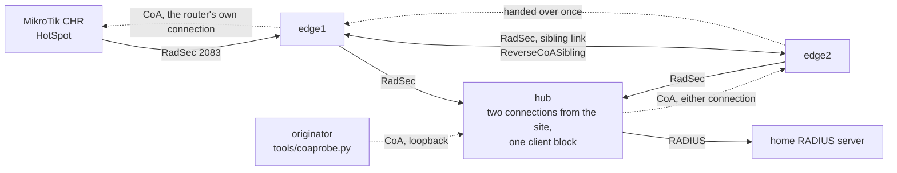

# Reverse CoA through a site with two proxies

Bench record for the Operator-Name-only series (commits c34e6b5 to ae52817): a site with two
proxies, both taking the NAS's connection and both connected to the hub; the hub routes on
Operator-Name alone and keeps no record of which connection a session was seen on; the proxy
that receives a request delivers it or hands it to the other over a sibling link, once. NAS:
MikroTik CHR, RouterOS 7.23.8 (long-term), HotSpot, one phone session. Date: 30 October 2026.

## Topology



The two edges run on one host as two instances (TLS 2083 and 2084, UDP 1822/1823 and
1832/1833), from one image built from the branch with the unit tests passing inside. Both
present the same client certificate to the hub, so at the hub they are two connections of one
client block, which is the shape of a site with several proxies. The sibling link is two RadSec
connections between the instances, one each way, with a certificate good for both TLS roles.
Every proxy has the same `ReverseCoATokenKey`. The hub is the development instance of an
IDP-side proxy on a second host, with the originator on its loopback.

Edge configuration, the parts that matter (edge1; edge2 is the same with the names swapped):

```
client bench-nas-radsec {        # the router over RadSec
    type tls
    NASidentifier Sebs-Test-Mikrotik
    ReverseCoAOperatorRealm 4IRONWIFI:US
    rewriteIn addoperatorname
    addOperatorNASIdentifier on
}
client edge2 {                   # sibling link, inbound
    type tls
    host 127.0.0.1
    tls sibling
    reverseCoASibling on
    idleTimeout 90
    tcpKeepalive on
}
server edge2 {                   # sibling link, outbound
    type tls
    host 127.0.0.1
    port 2084
    tls sibling
    statusServer on
    reverseCoASibling on
}
server idp-dev {                 # the hub
    type tls
    statusServer on
    acceptReverseCoA on
}
```

Hub: `client lab-edge { ReverseCoAOperatorRealm 4IRONWIFI:US; idleTimeout 180; tcpKeepalive on }`
and the originator block with `acceptCoA` and `reverseCoAFallback`. Nothing on the hub names
either edge or the NAS.

## The value in Operator-NAS-Identifier

The edge adds it to every Access-Request and Accounting-Request. Over UDP it was
`b304c8c694908fcd` (block name and the router's NAS-Identifier under the key); over RadSec it
was `9a80d17790c9bab6` (certificate subject and NAS-Identifier). After the router moved from
edge1 to edge2, edge2 added the same `9a80d17790c9bab6` to the first accounting packet it
forwarded: the value names the NAS, not the connection or the proxy.

```
13:16  edge1  add_operator_nas_identifier: added 9a80d17790c9bab6 to Accounting-Request (id 26) from client bench-nas-radsec
13:28  edge2  add_operator_nas_identifier: added 9a80d17790c9bab6 to Accounting-Request (id 39) from client bench-nas-radsec
```

## Runs

Each run is one request from the originator on the hub's loopback for the live session
(`tester3`, Acct-Session-Id `80f00037`, Framed-IP 10.5.50.254), with Operator-Name
`4IRONWIFI:US`, the router's own NAS-Identifier and NAS-IP-Address, and the value above. The
CoA-Requests carry `Mikrotik-Rate-Limit`, which the router applies to the session's dynamic
queue, checked with `/queue simple print` after each one. Times are UTC.

**1. Baseline, router over UDP to edge1** (13:14:12). Hub to edge2 (first registered); edge2
recomputed the value from its own `bench-nas` block, same name and key as on edge1, and sent
on UDP 3799 itself: a NAS reachable from both proxies needs no hand-over.
```
hub    send_coa_to_client: forwarding CoA-Request (id 146 -> 1) to client lab-edge
edge2  try_send_to_token_client: ... send_coa_to_client: forwarding CoA-Request (id 1 -> 0) to client bench-nas (nas)
edge2  radudpget: CoA-ACK (id 0) from 10.0.0.69 matched pending reverse coa of client bench-nas
probe  reply after 5.0 ms: CoA-ACK id 146
router <hotspot-tester3> max-limit=2M/2M
```

**2. Router over RadSec to edge1, hub picks edge1** (13:16:13). The value named the router's
connection on edge1 directly. ACK in 5.5 ms, 3M/3M.

**3. Hub picks edge2, hand-over to edge1** (13:17:51). The case the series exists for.
```
hub    send_coa_to_client: forwarding CoA-Request (id 139 -> 1) to client lab-edge
edge2  try_send_to_token_client: no nas carries the operator-nas-identifier
edge2  try_send_to_siblings: CoA-Request (id 1), handing to a sibling proxy
edge2  send_coa_to_client: forwarding CoA-Request (id 1 -> 1) to client edge1
edge1  handle_reverse_coa_request: received CoA-Request (id 1) from server edge2
edge1  try_send_to_token_client: operator-nas-identifier names a client connection
edge1  send_coa_to_client: forwarding CoA-Request (id 1 -> 0) to client bench-nas-radsec (nas)
edge1  forward_coa_response: CoA-ACK (id 0) from client bench-nas-radsec answers request id 1 from server edge2
edge2  forward_coa_response: CoA-ACK (id 1) from client edge1 answers request id 1 from server idp-dev
probe  reply after 5.5 ms: CoA-ACK id 139
router max-limit=4M/4M
```

**4. A NAS nobody has** (13:18:28): value `0000000000000000`, NAS-Identifier `nobody-here`.
Hub to edge2, handed to edge1 once, edge1 answered 403 and did not hand on; the hub relayed
the 403 without trying its other connection.
```
edge1  try_send_to_siblings: CoA-Request (id 2) came from sibling edge2, not handed on
edge1  dispatch_reverse_coa: no route for CoA-Request (id 2) with operator-name realm 4IRONWIFI:US, Error-Cause 403
hub    forward_coa_response: CoA-NAK (id 2) from client lab-edge with Error-Cause 403
probe  reply after 3.6 ms: CoA-NAK id 100, Error-Cause = 403
```

**5. Router moved to edge2** (13:28:51). The edges' TLS ports were swapped and both restarted;
the router reconnected and landed on edge2. The request carried the value recorded on edge1
before the move; edge2 matched it on the router's new connection directly. ACK in 4.6 ms,
8M/8M. (Two earlier attempts, 13:21 and 13:24, did not move the router at all: RouterOS kept
its RadSec session to edge1 through a port change and a disable/enable of the `/radius`
entry, and the requests were delivered through the sibling link, ACK, 5M and 6M. RouterOS
also connects to 2083 whatever the entry's port fields say.)

**6. Sibling link down** (13:34:39). Both directions of the link rejected on loopback; after
34 s edge1 had dropped the dead inbound connection and its route. Hub to edge1 first: 502;
the hub tried its other connection: edge2 held the router. ACK in 6.0 ms, 10M/10M.
```
edge1  dispatch_reverse_coa: no route for CoA-Request (id 0) with operator-name realm 4IRONWIFI:US, Error-Cause 502
hub    forward_coa_response: CoA-NAK (id 0) from client lab-edge with Error-Cause 502
hub    forward_coa_response: request id 218 tried on the next candidate after Error-Cause 502 from client lab-edge
edge2  try_send_to_token_client: operator-nas-identifier names a client connection
hub    forward_coa_response: CoA-ACK (id 0) from client lab-edge answers request id 218 from client idp-coa
```

**7. 403 from the router itself** (13:12:50). A request naming the NAS with the wrong
NAS-IP-Address: the router answered 403 on its own connection; the answer travelled edge1,
edge2, hub, probe, and the hub did not try its other connection. One delivery.

**8. Disconnect** (13:35:17). Hub to edge1, handed to edge2, delivered on the router's
connection, Disconnect-ACK in 6.1 ms; the session left `/ip hotspot active`, the dynamic
queue went, and the Accounting-Stop came up through edge2 to the hub.

## What the bench found that the unit tests could not

- **A connection that is gone keeps its route until the proxy notices.** Twice. At the hub,
  a third connection presenting the same certificate (an unrelated instance on the edge host)
  was registered for the realm and went silent; the first request was sent down it and
  vanished until `ReverseCoATimeout`, no NAK, so no retry (13:03). On the edge, with the
  sibling link cut in one direction, the hand-over reached edge2 and the router applied the
  change, and the answer died on the way back (13:29); with the link cut in both directions
  but before the dead connection was noticed, the request went into it and vanished
  (13:31). Remedy applied and now in the example configurations and the man page:
  `idleTimeout` and `tcpKeepalive` on every client block a reverse CoA can be routed to;
  with Status-Server from the peer, a dead link is dropped within two periods. Left for a
  later change: a request whose forwarded copy expired could be tried on the next candidate
  or answered 502, instead of expiring in silence; the originator's own retransmission
  within the duplicate window currently maps to the same dead route.
- **RouterOS RadSec**: the `/radius` entry's port fields are ignored for `protocol=radsec`
  (always 2083), and the TLS session survives a port change and a disable/enable of the
  entry; only the server side closing it makes the router reconnect.
- **The UDP path on two proxies**: the same block name under the same key gives the same
  value on both, so a UDP NAS reachable from both is served by whichever the hub picks,
  without the link. The RadSec path needs the link, because only one proxy holds the
  connection.
- **The probe must name the NAS as the NAS does**: a CoA with a NAS-IP-Address the router
  does not own is answered 403 by the router (run 7), as RFC 5176 section 3.5 says.

## Reproducing

Build the image or the binary from the branch tip; two instances from `examples/reverse-coa/
anp-edge1.conf` and `anp-edge2.conf`, one from `idp-proxy.conf`; the NAS pointed at either
edge; `tools/coaprobe.py` on the hub's loopback with `op=`, `nas=`, `nasip=` and `oni=` set to
what the NAS sent and what the edge added (visible at log level 5 as
`add_operator_nas_identifier: added ...`). Force the hub's order by restarting the edge that
should not be picked first; it registers last.
