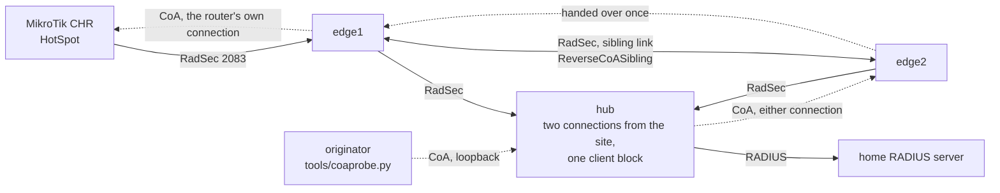

# Reverse CoA through a site with two proxies

Bench record for the Operator-Name-only series (commits c34e6b5 to ae52817): a site with two
proxies, both taking the NAS's connection and both connected to the hub; the hub routes on
Operator-Name alone and keeps no record of which connection a session was seen on; the proxy
that receives a request delivers it or hands it to the other over a sibling link, once. NAS:
MikroTik CHR, RouterOS 7.23.8 (long-term), HotSpot, one phone session. Date: 30 October 2026.

## Topology



The two edges run on one host as two instances (TLS 2083 and 2084, UDP 1822/1823 and
1832/1833), from one image built from the branch with the unit tests passing inside. Both
present the same client certificate to the hub, so at the hub they are two connections of one
client block, which is the shape of a site with several proxies. The sibling link is two RadSec
connections between the instances, one each way, with a certificate good for both TLS roles.
Every proxy has the same `ReverseCoATokenKey`. The hub is the development instance of an
IDP-side proxy on a second host, with the originator on its loopback.

Edge configuration, the parts that matter (edge1; edge2 is the same with the names swapped):

```
client bench-nas-radsec {        # the router over RadSec
    type tls
    NASidentifier Sebs-Test-Mikrotik
    ReverseCoAOperatorRealm 4IRONWIFI:US
    rewriteIn addoperatorname
    addOperatorNASIdentifier on
}
client edge2 {                   # sibling link, inbound
    type tls
    host 127.0.0.1
    tls sibling
    reverseCoASibling on
    idleTimeout 90
    tcpKeepalive on
}
server edge2 {                   # sibling link, outbound
    type tls
    host 127.0.0.1
    port 2084
    tls sibling
    statusServer on
    reverseCoASibling on
}
server idp-dev {                 # the hub
    type tls
    statusServer on
    acceptReverseCoA on
}
```

Hub: `client lab-edge { ReverseCoAOperatorRealm 4IRONWIFI:US; idleTimeout 180; tcpKeepalive on }`
and the originator block with `acceptCoA` and `reverseCoAFallback`. Nothing on the hub names
either edge or the NAS.

## The value in Operator-NAS-Identifier

The edge adds it to every Access-Request and Accounting-Request. Over UDP it was
`b304c8c694908fcd` (block name and the router's NAS-Identifier under the key); over RadSec it
was `9a80d17790c9bab6` (certificate subject and NAS-Identifier). After the router moved from
edge1 to edge2, edge2 added the same `9a80d17790c9bab6` to the first accounting packet it
forwarded: the value names the NAS, not the connection or the proxy.

```
13:16  edge1  add_operator_nas_identifier: added 9a80d17790c9bab6 to Accounting-Request (id 26) from client bench-nas-radsec
13:28  edge2  add_operator_nas_identifier: added 9a80d17790c9bab6 to Accounting-Request (id 39) from client bench-nas-radsec
```

## Runs

Each run is one request from the originator on the hub's loopback for the live session
(`tester3`, Acct-Session-Id `80f00037`, Framed-IP 10.5.50.254), with Operator-Name
`4IRONWIFI:US`, the router's own NAS-Identifier and NAS-IP-Address, and the value above. The
CoA-Requests carry `Mikrotik-Rate-Limit`, which the router applies to the session's dynamic
queue, checked with `/queue simple print` after each one. Times are UTC.

**1. Baseline, router over UDP to edge1** (13:14:12). Hub to edge2 (first registered); edge2
recomputed the value from its own `bench-nas` block, same name and key as on edge1, and sent
on UDP 3799 itself: a NAS reachable from both proxies needs no hand-over.
```
hub    send_coa_to_client: forwarding CoA-Request (id 146 -> 1) to client lab-edge
edge2  try_send_to_token_client: ... send_coa_to_client: forwarding CoA-Request (id 1 -> 0) to client bench-nas (nas)
edge2  radudpget: CoA-ACK (id 0) from 10.0.0.69 matched pending reverse coa of client bench-nas
probe  reply after 5.0 ms: CoA-ACK id 146
router <hotspot-tester3> max-limit=2M/2M
```

**2. Router over RadSec to edge1, hub picks edge1** (13:16:13). The value named the router's
connection on edge1 directly. ACK in 5.5 ms, 3M/3M.

**3. Hub picks edge2, hand-over to edge1** (13:17:51). The case the series exists for.
```
hub    send_coa_to_client: forwarding CoA-Request (id 139 -> 1) to client lab-edge
edge2  try_send_to_token_client: no nas carries the operator-nas-identifier
edge2  try_send_to_siblings: CoA-Request (id 1), handing to a sibling proxy
edge2  send_coa_to_client: forwarding CoA-Request (id 1 -> 1) to client edge1
edge1  handle_reverse_coa_request: received CoA-Request (id 1) from server edge2
edge1  try_send_to_token_client: operator-nas-identifier names a client connection
edge1  send_coa_to_client: forwarding CoA-Request (id 1 -> 0) to client bench-nas-radsec (nas)
edge1  forward_coa_response: CoA-ACK (id 0) from client bench-nas-radsec answers request id 1 from server edge2
edge2  forward_coa_response: CoA-ACK (id 1) from client edge1 answers request id 1 from server idp-dev
probe  reply after 5.5 ms: CoA-ACK id 139
router max-limit=4M/4M
```

**4. A NAS nobody has** (13:18:28): value `0000000000000000`, NAS-Identifier `nobody-here`.
Hub to edge2, handed to edge1 once, edge1 answered 403 and did not hand on; the hub relayed
the 403 without trying its other connection.
```
edge1  try_send_to_siblings: CoA-Request (id 2) came from sibling edge2, not handed on
edge1  dispatch_reverse_coa: no route for CoA-Request (id 2) with operator-name realm 4IRONWIFI:US, Error-Cause 403
hub    forward_coa_response: CoA-NAK (id 2) from client lab-edge with Error-Cause 403
probe  reply after 3.6 ms: CoA-NAK id 100, Error-Cause = 403
```

**5. Router moved to edge2** (13:28:51). The edges' TLS ports were swapped and both restarted;
the router reconnected and landed on edge2. The request carried the value recorded on edge1
before the move; edge2 matched it on the router's new connection directly. ACK in 4.6 ms,
8M/8M. (Two earlier attempts, 13:21 and 13:24, did not move the router at all: RouterOS kept
its RadSec session to edge1 through a port change and a disable/enable of the `/radius`
entry, and the requests were delivered through the sibling link, ACK, 5M and 6M. RouterOS
also connects to 2083 whatever the entry's port fields say.)

**6. Sibling link down** (13:34:39). Both directions of the link rejected on loopback; after
34 s edge1 had dropped the dead inbound connection and its route. Hub to edge1 first: 502;
the hub tried its other connection: edge2 held the router. ACK in 6.0 ms, 10M/10M.
```
edge1  dispatch_reverse_coa: no route for CoA-Request (id 0) with operator-name realm 4IRONWIFI:US, Error-Cause 502
hub    forward_coa_response: CoA-NAK (id 0) from client lab-edge with Error-Cause 502
hub    forward_coa_response: request id 218 tried on the next candidate after Error-Cause 502 from client lab-edge
edge2  try_send_to_token_client: operator-nas-identifier names a client connection
hub    forward_coa_response: CoA-ACK (id 0) from client lab-edge answers request id 218 from client idp-coa
```

**7. 403 from the router itself** (13:12:50). A request naming the NAS with the wrong
NAS-IP-Address: the router answered 403 on its own connection; the answer travelled edge1,
edge2, hub, probe, and the hub did not try its other connection. One delivery.

**8. Disconnect** (13:35:17). Hub to edge1, handed to edge2, delivered on the router's
connection, Disconnect-ACK in 6.1 ms; the session left `/ip hotspot active`, the dynamic
queue went, and the Accounting-Stop came up through edge2 to the hub.

## What the bench found that the unit tests could not

- **A connection that is gone keeps its route until the proxy notices.** Twice. At the hub,
  a third connection presenting the same certificate (an unrelated instance on the edge host)
  was registered for the realm and went silent; the first request was sent down it and
  vanished until `ReverseCoATimeout`, no NAK, so no retry (13:03). On the edge, with the
  sibling link cut in one direction, the hand-over reached edge2 and the router applied the
  change, and the answer died on the way back (13:29); with the link cut in both directions
  but before the dead connection was noticed, the request went into it and vanished
  (13:31). Remedy applied and now in the example configurations and the man page:
  `idleTimeout` and `tcpKeepalive` on every client block a reverse CoA can be routed to;
  with Status-Server from the peer, a dead link is dropped within two periods. Left for a
  later change: a request whose forwarded copy expired could be tried on the next candidate
  or answered 502, instead of expiring in silence; the originator's own retransmission
  within the duplicate window currently maps to the same dead route.
- **RouterOS RadSec**: the `/radius` entry's port fields are ignored for `protocol=radsec`
  (always 2083), and the TLS session survives a port change and a disable/enable of the
  entry; only the server side closing it makes the router reconnect.
- **The UDP path on two proxies**: the same block name under the same key gives the same
  value on both, so a UDP NAS reachable from both is served by whichever the hub picks,
  without the link. The RadSec path needs the link, because only one proxy holds the
  connection.
- **The probe must name the NAS as the NAS does**: a CoA with a NAS-IP-Address the router
  does not own is answered 403 by the router (run 7), as RFC 5176 section 3.5 says.

## Evening runs, 30 October: a value per name, and the hub walking on 403

Same topology, the series plus two changes made after the maintainer's reading of it: a
connection keeps a value per name the NAS has used (NAS-Identifier, NAS-IP-Address or
NAS-IPv6-Address, the peer address) and a request carrying any of them reaches it, a udp
NAS is named by the address it is reached at; and `ReverseCoARetryOn403`, off by default,
lets a hub move a request to the next proxy of the realm on a 403 as it does on a 502.
New login, `tester3`, Acct-Session-Id `80f00044`, router on edge2 (17:50:31). Times UTC.

**1. Regression** (17:52:57). Known value `9a80d17790c9bab6`, hub to edge1, handed to
edge2, delivered. ACK 5.2 ms, 2M/2M.

**2. The address's value** (17:53:15). The same request carrying `6568454d86f6655d`, the
value for the router's NAS-IP-Address under the key, computed offline and never put on any
packet by a proxy: the edge had learned it from the router's own requests, which carry
both NAS-Identifier and NAS-IP-Address. Hub to edge1, handed to edge2, matched on the
router's connection. ACK 4.4 ms, 3M/3M. This is the case where the home holds the value
from one packet and the NAS named itself another way in the next.

**3. Hub walks on 403** (17:54:47, option on at the hub). The request names the router with
a NAS-IP-Address it does not own, so the router itself answers 403 (RFC 5176 3.5). Hub to
edge1, handed to edge2, 403 from the router; the hub moved to its second connection, edge2,
the router answered 403 again; the hub then moved to its third connection and the request
vanished until the timeout: a third instance on the edge host with the same certificate,
an older build without reverse CoA handling, had registered for the realm. The walk
reaches whatever is registered, so a candidate that takes a request and never answers
ends the walk in silence, the same gap as this morning's, and the reason "move on when a
forwarded copy expires" is the next change. Rerun with that instance stopped (**3b**,
17:57:14): 403, walk, 403, the last 403 relayed. NAK 3.6 ms. The router saw the refused
request twice, which is the cost the option carries and why it is off by default.
```
hub    forward_coa_response: CoA-NAK (id 1) from client lab-edge with Error-Cause 403
hub    forward_coa_response: request id 28 tried on the next candidate after Error-Cause 403 from client lab-edge
hub    forward_coa_response: CoA-NAK (id 1) from client lab-edge with Error-Cause 403
hub    forward_coa_response: CoA-NAK (id 1) from client lab-edge answers request id 28 from client idp-coa
```

**4. Disconnect** (17:59:35, option off again). Hub to edge1, handed to edge2, delivered;
Disconnect-ACK 4.0 ms; the session left `/ip hotspot active` and the Accounting-Stop came
up through edge2 to the hub.

## 3 November: the fixes from the blind reviews, on the bench

Same hub and edges, the build with the review fixes (a candidate listed once; the plan freed
when a named NAS took the request; expired requests handled by a sweeper thread, the next
candidate or a 502 to the originator; a tls NAS with `addOperatorNASIdentifier` as the final
hop; a `/regexp/` block naming the NAS by what it learned; TTL on the server path). No
hotspot session this time: the runs below need none. Times UTC. Run directories under
`/root/bench-ono/s1..s8b-*` on the hub host.

- **Smoke, no NAS anywhere** (13:14:34). Hub to one edge, 502 after the sibling hand-over,
  hub to the other, 502, relayed. NAK in 2.8 ms.
- **Silent candidate** (13:17:31, `ReverseCoARetryOn403` on, the older instance up again as
  a third connection of the realm, silent). Two 502s, then the request sat on the silent
  connection; the sweeper expired it at 30 s and answered the originator 502. NAK after
  30963 ms. On the 30 October build the same request vanished for good.
- **Deadlock, before and after** (13:19 and 13:20). Hub block declaring the realm twice, a
  request left on the silent connection, a second request after the timeout. Previous
  binary: the second request hit the expiry inside the send and the hub never logged
  another line; a third request was not even read by the listener; the service stayed
  "active". New binary, same configuration: the realm declared twice gave one candidate,
  both later requests were answered 502 after 30 s, 26 threads, alive.
- **Memory** (13:23 to 13:40). 600 requests twice on the previous binary and twice on the new
  one grew the hub by the same 1.7 to 1.9 MB per 600. Under AddressSanitizer with a clean
  exit the leak checker reported nothing. The probe sent every request from a fresh source
  port; the hub keeps a udp client entry per source address and port for 60 s (upstream
  behaviour) and each carries a 256-slot request table. Bound to one source port: +132 KB
  for the first 300, +12 KB for the next 300. Not a leak; an originator uses one port.
- **Sustained load** (13:36, one request a second for five minutes at a silent candidate).
  269 expiries handled, 238 originators answered 502, 31 dropped because the probe reused a
  random Identifier while the earlier request was pending (the later one replaces it, as
  for any client). Hub alive; a request after the storm answered at 31.7 s.
- **Burst** (13:43, 300 requests at once). 256 parked on the silent connection and answered
  502 at expiry, 44 beyond the Identifier space refused with 505 at once, all 300 answered
  within 39 s, no thread or descriptor growth.

Still owed a session on the router: the regression of the four October runs on this build,
and the sibling link cut while the far edge holds the NAS, which should now end in a 502 at
the timeout instead of the 34 s route drop.

## 4 November: a session on a third edge, udp NAS, through the same hub

The two lab edges as before, plus a third edge of the realm running on a laptop: a
radsecproxy from this build with a udp client block for a RouterOS CHR (7.23.8) on the
laptop's virtual network, connecting to the hub over a VPN with the same client
certificate and token key, so the hub sees three connections of one client block. The
session (`tester3`) was logged in on the CHR's HotSpot from the laptop itself by HTTP PAP;
the value the edge added was the udp one, from the block name and the address the router
reports (`e1a63268c9943892`). The originator did not send Acct-Session-Id (RouterOS does
not show it); the router matched the session on User-Name and Framed-IP-Address. An
older instance on the lab host, silent to reverse CoA, was also registered. Times UTC.

- **Rate limit, wrong session id** (13:45:40). Hub to a lab edge, 502; to the silent
  instance, no answer, moved on by the sweeper at 30 s; to the other lab edge, 502; to the
  laptop edge, udp 3799 to the router, which refused with 406 (RouterOS: "request has
  wrong attributes", the guessed Acct-Session-Id). NAK relayed after 36832 ms: the walk
  across three sites and a silent one, ending at the NAS's own answer.
- **Rate limit, no session id** (13:47:06). Hub to a lab edge, 502; to the laptop edge;
  the router applied it ("Radius CoA succeeded"). ACK 200.9 ms.
- **Disconnect** (13:47:33). Same path, Disconnect-ACK 164.4 ms, "logged out: radius
  disconnect", the Accounting-Stop up through the laptop edge to the hub.

Still owed: the sibling link cut with the far edge holding a RadSec NAS, which needs the
session on the lab router.

## 4 November, evening: the October runs over RadSec on the final build

The RouterOS CHR on the laptop again, this time as a RadSec NAS: the lab client certificate
imported, a `/radius` entry with `protocol=radsec` to a TCP relay on the laptop that carries
the connection into the VPN and on to edge2's port 2083, and a client block for the laptop's
VPN address on each edge. Two things about RouterOS found on the way: it matches the
server certificate's names against the address it dialled, so the edges' certificate was
reissued with the relay address in its subject alternative names; and the `/radius` entry's
`timeout` applies to RadSec too, so a home server four seconds away needs more than the
default. The silent instance was stopped for these runs. Session `tester3`, the value
the edge added `951c2f8e5f067c4d` (NAS-Identifier `OCC-IronWifi-MT-Test`). Times UTC.

- **Hand-over** (20:29:02). Hub to edge1, no NAS, handed to edge2, delivered on the
  router's RadSec connection. ACK 157.6 ms, "Radius CoA succeeded".
- **The address's value over RadSec** (20:29:26). The same request carrying
  `e252f947e4625ced`, the value for the router's NAS-IP-Address, computed offline and never
  put on a packet by a proxy; the connection had learned it from the router's own requests.
  ACK 127.6 ms.
- **The router's own 403, walked** (20:30:11, `ReverseCoARetryOn403` on). Wrong
  NAS-IP-Address: hub to edge1, handed to edge2, 403 from the router; the hub moved to
  edge2 directly, 403 again, the last 403 relayed. NAK 145.2 ms.
- **Sibling link cut, far edge holds the NAS** (20:30:47, both directions rejected on the
  loopback). edge1 handed the request down its sibling connection, which was dead but not yet
  noticed; the sweeper expired it at 30 s and edge1 answered 502; the hub moved to edge2,
  which delivered. ACK 30947 ms. The hub's own timer for the request expired in the same
  second, so the edge's 502 reached a request the hub had already moved on from: the hub's
  `ReverseCoATimeout` on its edge blocks should exceed the edges' sibling timeout, so the
  edge's answer is what moves the hub. On the 30 October build this request was lost until
  the route dropped at 34 s.
- **Disconnect** (20:31:47). Hand-over, Disconnect-ACK 112.4 ms, "logged out: radius
  disconnect", the Accounting-Stop up through edge2 to the hub.

## 4 November, late evening: the second review's fixes, on the bench

The full series went through a cold multi-agent review and came back with ten findings
(three of them pre-existing on the base branch, one of those documentation only, one out of
scope). The fixes: the reverse CoA state under its own mutex so no thread holding the global
or a block lock ever waits on a connection's I/O lock; a client torn down with requests in
flight hands them to the expiry path at once; an answer that matches nothing in flight is
dropped before decoding instead of closing a tls client's connection; the duplicate-cache
purge no longer detaches the originating client from a request still in flight; a request to
a udp or dtls NAS is sent again every 5 s until answered or expired; an address string copied
under the lock in the shared-value warning. 551 unit tests (20 new) on the Mac, on the build
host (normal and AddressSanitizer) and inside the edge image build. The same hub and two
edges, both edges and the hub on the fixed build; a udp client block `dead-nas` at
192.0.2.250 (TEST-NET-1, nothing answers) on both edges for the runs that need a request to
sit. Times UTC, run directories `/root/bench-ono/f1..f9-*` on the hub host.

- **Smoke** (21:30:05, unknown NAS on the edges). 403 relayed in 1.7 ms. The first attempt
  seven seconds after the edges restarted went to a third `lab-edge` connection, the stage-6
  edge still running from October, which ignores reverse CoA: 30 s on it, then the next
  candidate. Stopped for the rest of the runs, as the 3 November note says to.
- **Resend to a udp NAS** (21:30:33, tcpdump on the edge host). The edge sent the request at
  0, 5, 10, 15, 20, 25 and 30 s, seven datagrams on the wire, 502 at 31 s; the hub, with the
  same 30 s on its edge block, had moved the request to the other edge in the same second
  and its 502 came at 62 s, after the probe's 40 s. The late 502 from the first edge was
  caught by the response path: "no pending reverse coa request ... ignoring", both edge
  connections kept.
- **Late answers with the hub timer shorter than the edges'** (21:33:24, hub edge block at
  10 s). 502 to the probe at 22.3 s after both edges were tried; the edges' own 502s arrived
  at 31 and 42 s and were dropped in `radsrv` before decoding ("answers no reverse coa
  request in flight, ignoring"); both connections kept the same ports; a smoke probe after
  them answered in 2.6 ms. On the base branch that late answer closes the edge's connection.
- **Teardown while parked** (21:34:41). Request parked on edge1, edge1's container restarted
  at +5 s: the hub logged "went away with reverse coa request id 2 in flight", sent the
  request to edge2 in the same second, and the probe got its 502 at 17.3 s, the hub's own 10 s
  timer on edge2 plus the 5 s. Before the fix the request was freed and the originator heard
  nothing until the dedup window passed.
- **Dup-cache purge while parked** (21:38:41, `DuplicateInterval 10` on the originating
  client). Two requests from one socket: A parked at the dead NAS, B 15 s later for an
  unknown NAS. B answered 403 in 2.1 ms and purged A's cache entry; A still got its 502 at
  22.0 s. Before the fix the purge cleared A's client pointer and the 502 was dropped as
  "client gone".
- **Mixed load** (21:40:35). 120 requests at one per 0.7 s for an unknown NAS while 20
  requests parked on the dead NAS with their resends and walks: 120 of 120 answered 403
  (1.3 to 41.3 ms), all 20 parked requests answered 502, 40 late answers dropped, no error
  line, RSS 9888 KB before and 9944 KB after the expiries, 24 threads throughout, both edge
  connections unchanged.
- **AddressSanitizer** (21:49:48, hub on the ASan build with SIGTERM turned into `exit()` so
  the leak checker runs). Smoke 3.2 ms, the two-edge walk 62.5 s, teardown hand-over
  ("went away ... in flight", 502 at 37.3 s), 30 of 30 under load, late answers dropped;
  exit through the handler, no sanitizer or leak report. A control program with a 64-byte leak
  built the same way does report, so the silence is a result.
- **Restored** (21:55). Hub configuration back to its normal timeouts and the 255 s duplicate
  interval; the edges back to their configurations without `dead-nas`, on the fixed image;
  the stage-6 edge started again; a smoke probe through the restored edges answered in
  3.7 ms (502: with no NAS registered at an edge the realm is not served there).

Not run on this build: the router sessions (the RadSec and udp NAS runs of 4 November
afternoon and evening). The code paths they exercise beyond the above are the NAS's own ACK
on a real connection and the hand-over to the edge holding it; both ran unchanged in the unit
tests, and the ACK path on a live connection is the next thing to repeat.

## 5 November: the router sessions and hostapd on two edges, on the final build

The final build (series tip, commit 11 included) on the hub and both edges, the Mac edge for
the udp case on the same source. The three scenarios the 4 November record listed as not run
on this build, plus the two never run on any build. Times UTC, run directories
`/root/bench-ono/h1b*, h2*, c1b*, c2b*, c3*, u1b*, u2b*` on the hub host; the hostapd and
wpa_supplicant logs under `/root/rcoa-bench/logs-twoedge/` on the hostapd host.

- **hostapd, authentication on edge1 and accounting on edge2** (07:53). hostapd on its
  virtual radio with the bundled supplicant, auth server edge1 (2084), accounting server
  edge2 (2083), identity bob@coa.lab answered through the hub. Disconnect through the hub:
  the hub picked edge1, which sent it down hostapd's authentication connection,
  Disconnect-ACK in 4.5 ms, station deauthenticated, supplicant reconnected. A first probe
  with the inner identity as User-Name was refused 503 by hostapd itself: the session's
  User-Name is the outer one (anonymous@coa.lab), the Acct-Session-Id matched. Then edge1
  restarted so the hub would pick edge2, which holds only the accounting connection: the
  Disconnect went down that connection, ACK in 8.9 ms, station deauthenticated. Both edges
  name the NAS by the same value and either connection carries the request (07:54, 07:55).
- **The router over RadSec, hand-over** (08:00). UTM CHR on the lab edge through the Mac
  relay, hotspot login tester3. CoA with Mikrotik-Rate-Limit: hub to edge1, no NAS there,
  hand-over to the sibling edge2 holding the router, CoA-ACK in 114.8 ms, router log "Radius
  CoA succeeded". The login first failed twice with "RADIUS server is not responding": the
  backend answered in about 4 s and RouterOS applies a separate radsec-timeout of 3.3 s;
  raised to 10 s on the entry for the window.
- **The router moving to the other edge mid-session** (08:01 to 08:03). The relay retargeted
  from edge2 to edge1; the router's connection dropped and RouterOS reconnects only when it
  next needs RADIUS, so a CoA sent in that gap found no router anywhere and was answered 502
  after the walk (expected). A Disconnect at 08:02 found it back on edge1, Disconnect-ACK in
  91 ms, router "logged out: radius disconnect". Logged in again on edge1: edge1 added the
  same value as edge2 had (951c2f8e5f067c4d), CoA straight down edge1, CoA-ACK in 219 ms.
- **The router as a udp NAS behind the Mac edge** (08:04 to 08:07). Router entry switched to
  udp towards the Mac edge, Mac edge registered at the hub for the realm. CoA: hub walked the
  two lab edges (502 at once each), then the Mac edge, udp to the router's 3799, CoA-ACK in
  133.8 ms; Disconnect-ACK in 139.4 ms, user logged out. The first attempt took 30.9 s because
  the stage-6 edge was registered at the hub again and silent; stopped, repeated.
- **Restored** (08:08). Router: the lab entries, certificates and files removed, the SmartCity
  entry enabled, backups kept. Mac: edge and relays stopped, certificate copies wiped.

## Reproducing

Build the image or the binary from the branch tip; two instances from `examples/reverse-coa/
anp-edge1.conf` and `anp-edge2.conf`, one from `idp-proxy.conf`; the NAS pointed at either
edge; `tools/coaprobe.py` on the hub's loopback with `op=`, `nas=`, `nasip=` and `oni=` set to
what the NAS sent and what the edge added (visible at log level 5 as
`add_operator_nas_identifier: added ...`). Force the hub's order by restarting the edge that
should not be picked first; it registers last.
